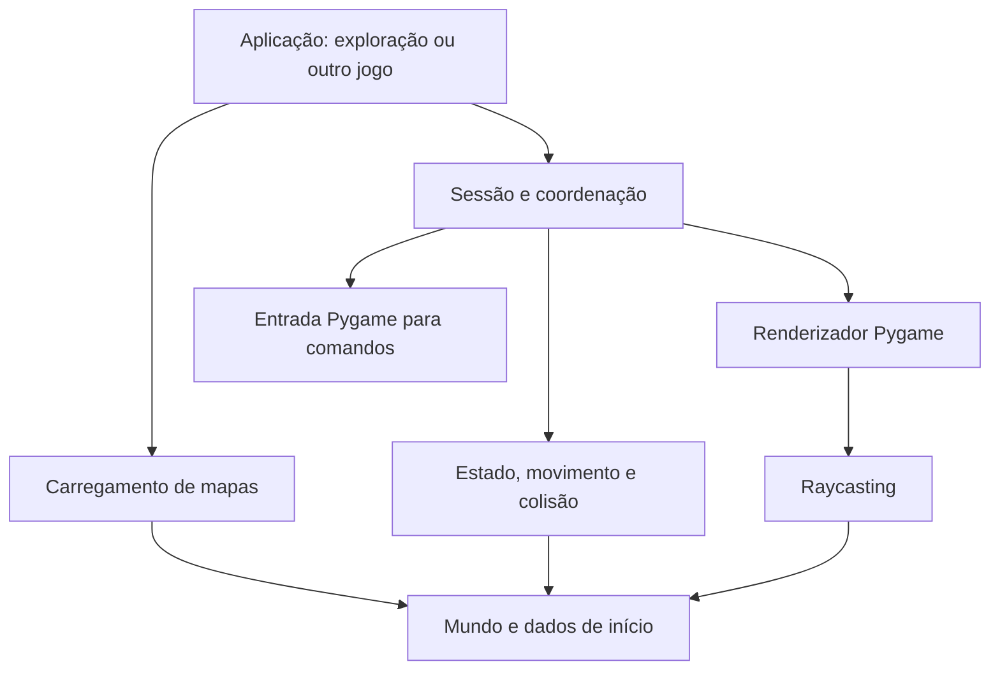

# Arquitetura inicial — RetroFPS Engine

## 1. Intenção e estado

A engine oferecerá mecanismos reutilizáveis para jogos baseados em ambientes de grade, inspirados visualmente em Wolfenstein 3D. Em M0-3, `engine.run()` passou a abrir a janela, processar eventos de encerramento e liberar recursos; `__main__` chama esse executor. M0-4 e M0-5 acrescentaram configuração da janela, medição em segundos e desenho de cor sólida. M1-1 implementou `World`, descrito na seção 11; M1-2 acrescentou a sala temporária descrita na seção 12. M2 implementou câmera, projeção e desenho; M3, comandos e colisões; M4 implementou carregamento e seleção do mapa, com conferência manual ainda pendente. Os contratos abaixo continuam propostas onde não identificados como implementados.

Reutilização significa que outro programa pode importar a engine, fornecer um mundo e controlar uma sessão sem copiar o renderizador ou editar suas regras internas. Não significa oferecer antecipadamente um editor, um sistema universal de plugins ou suporte a qualquer tipo de jogo.

## 2. Estrutura

```text
retro_fps_engine/
├── README.md
├── AGENTS.md
├── pyproject.toml
├── docs/
│   ├── missao.md
│   ├── pilha_tecnologica.md
│   ├── roadmap.md
│   ├── arquitetura.md
│   ├── formato_mapa.md
│   ├── validacao.md
│   └── uso_ia.md
├── src/retro_fps/
│   ├── __init__.py
│   ├── __main__.py
│   ├── config.py
│   ├── engine.py
│   ├── world.py
│   ├── player.py
│   ├── collision.py
│   ├── raycasting.py
│   ├── renderer.py
│   └── map_loader.py
├── examples/exploration/
├── maps/
│   ├── room.map
│   └── corridor.map
├── assets/textures/
└── tests/
```

## 3. Responsabilidades e limites

| Módulo | Responsabilidade planejada | Limite |
|---|---|---|
| `world` | Grade, dimensões e consultas de células | Sem janela, leitura de arquivo ou regras de vitória |
| `map_loader` | Leitura, análise e validação; criação dos dados do mundo e início | Sem iniciar Pygame |
| `player` | Estado de posição e orientação; intenção de movimento | Sem consultar teclado diretamente |
| `collision` | Validar volume e resolver deslocamento contra a grade | Sem desenhar ou decidir objetivos |
| `raycasting` | Percorrer grade e retornar impactos por raio | Sem dependência de Pygame |
| `renderer` | Converter impactos em colunas e apresentar piso e teto | Sem alterar o mundo ou o jogador |
| `engine` | Coordenar sessão, entrada, atualização, desenho e encerramento | Sem inventário, chave ou vitória |
| `examples/exploration` | Configurar e executar a demonstração usando a API pública | Sem duplicar algoritmos do núcleo |

Dependências seguem a direção dos mecanismos básicos: o coordenador usa os componentes; mundo e geometria não importam o coordenador nem os exemplos. Pygame fica concentrado na coordenação de entrada/apresentação e no renderizador.

## 4. Contratos iniciais a desenvolver

- **Mundo (implementado em M1-1):** grade retangular imutável, dimensões e consultas de células e solidez; contrato na seção 11.
- **Início:** posição e orientação separadas da geometria, permitindo que uma aplicação escolha outro início válido.
- **Estado do jogador:** posição contínua e ângulo em radianos. Velocidades e raio pertencem à configuração explícita da sessão, evitando valores escondidos em vários módulos.
- **Comando de movimento:** avanço e giro, independentes das teclas físicas. O adaptador de entrada traduz teclado em comandos; testes e outros jogos podem fornecer comandos diretamente.
- **Impacto de raio:** célula atingida, lado atingido e parâmetro de distância. Sua unidade deve ser documentada; a distância perpendicular depende da convenção da direção do raio.
- **Configuração:** resolução, campo de visão, velocidades e volume do jogador definidos explicitamente e validados antes da sessão.
- **Sessão:** a aplicação fornece mundo, início e configuração; pode solicitar atualização e desenho e controlar seu ciclo de vida. Um executor simples poderá cuidar do loop para a demonstração.

Os nomes e assinaturas serão definidos em cada marco, quando houver informação suficiente. A API pública só deverá ser exportada por `__init__.py` quando estiver implementada e testada.

## 5. Decisões geométricas propostas

A câmera será representada por direção unitária e um vetor perpendicular que representa o plano da câmera. Cada coluna usa uma direção calculada a partir desses vetores, sem normalizar individualmente esse raio. Com essa convenção, o parâmetro de impacto do DDA corresponde à profundidade perpendicular usada na projeção; não se aplica uma segunda correção por cosseno.

O jogador será um círculo de raio inicial 0.2 unidade. A colisão círculo-retângulo compara o centro com o ponto mais próximo na célula sólida. O deslocamento será resolvido por eixos para permitir deslizar ao longo de paredes; cantos e a influência da ordem dos eixos devem ser validados.

O movimento usa segundos e velocidade em unidades por segundo. A proposta inicial limita o intervalo aceito por atualização a 0.1 segundo e subdivide o deslocamento em passos de no máximo 0.1 unidade. Isso evita saltar uma parede com uma única verificação de destino. O tempo excedente após travamentos é descartado nesta abordagem; a limitação será explicada e poderá ser revista. Nenhuma dessas medidas substitui os testes de cantos e passos grandes.

## 6. Separação entre engine e jogo

Um jogo de fuga poderá usar a posição do jogador para verificar uma zona de saída e manter seu próprio estado de vitória. Outro poderá usar os mesmos componentes apenas para exploração. A engine não deve importar nenhum desses jogos.

A comprovação mínima de reutilização será o exemplo externo importar o pacote, carregar dois cenários e executar a mesma engine com configurações diferentes. Caso se adicione um jogo com objetivo, a regra deverá ficar fora de `src/retro_fps/`. Não é necessário construir um segundo jogo completo para validar a entrega básica.

## 7. Estilo arquitetural explícito

A proposta adota uma **arquitetura modular em um único processo, com separação entre núcleo computacional e infraestrutura de entrada e apresentação**. O pacote é uma biblioteca; a demonstração é uma aplicação cliente dessa biblioteca. Os limites são mantidos por módulos e contratos, sem serviços separados ou comunicação de rede.

Uma arquitetura descreve as partes principais, suas responsabilidades e as dependências permitidas. Um padrão de projeto resolve um problema mais localizado. Ter um arquivo por responsabilidade ajuda, mas os limites só existirão de fato se as dependências e o comportamento os respeitarem. Atualmente temos o ciclo inicial de janela e o mundo independente de Pygame; as relações com os demais componentes geométricos ainda aguardam implementação.

### Organização lógica e dependências



As setas representam dependência de código planejada, não a ordem de execução. Os blocos são responsabilidades lógicas; não exigem criar um arquivo ou classe para cada um imediatamente.

O carregador e os adaptadores gráficos ficam nas bordas. Mundo, colisões e raycasting não conhecem arquivos de demonstração, teclas ou janela. A coordenação pode conhecer componentes concretos inicialmente; não estamos prometendo uma infraestrutura gráfica totalmente substituível desde o primeiro marco.

### Relação com arquitetura hexagonal e Clean Architecture

A proposta aproveita a ideia de manter a lógica interna utilizável por diferentes entradas. Um comando de avanço pode vir do teclado, de um teste ou de outro programa. Essa ideia é central à [arquitetura hexagonal de Alistair Cockburn](https://alistair.cockburn.us/hexagonal-architecture/).

Ainda não adotamos uma arquitetura hexagonal completa com todas as portas e adaptadores formalizados, nem as camadas formais da Clean Architecture. Chamá-la de uma implementação completa desses estilos seria antecipar estruturas que ainda não existem. Se surgir necessidade real de trocar apresentação ou controle, poderemos definir contratos explícitos, por exemplo com `typing.Protocol`, nas fronteiras relevantes.

Também não adotamos MVC formal: embora existam dados e apresentação separados, a interação da engine será organizada pelo ciclo de atualização e desenho, sem exigir a divisão clássica em Model, View e Controller.

## 8. Padrões e princípios que orientam a implementação

| Padrão ou princípio | Aplicação planejada | Benefício e cuidado |
|---|---|---|
| Game Loop | Repetir coleta de entrada, atualização do estado e desenho | Torna explícita a evolução no tempo; o loop não deve acumular toda a lógica |
| Separação de responsabilidades | Leitura em `map_loader`, geometria em `raycasting`, desenho em `renderer` | Permite entender e testar partes menores; separar arquivos sem separar dependências não basta |
| Composição | Criar a sessão fornecendo mundo e configuração | Jogos combinam os mesmos mecanismos; evitar uma árvore de subclasses para cada jogo |
| Injeção de dependências por parâmetros | Fornecer componentes e dados ao coordenador em vez de buscá-los em variáveis globais | Facilita testar e reutilizar; não exige um framework de injeção |
| Núcleo funcional e borda com efeitos | Preferir cálculos que recebem dados e retornam resultados; concentrar arquivo, teclado e tela nas bordas | Facilita conferir matemática; o estado da sessão continua mudando, portanto não é um programa puramente funcional |

A sequência de Game Loop é coerente com o [exemplo básico da documentação do Pygame](https://www.pygame.org/docs/). Atualização e apresentação são responsabilidades distintas mesmo quando ocorrem no mesmo laço e na mesma frequência inicial.

Um comando lógico de movimento será inicialmente um dado simples. Isso não implica adotar o padrão Command com objetos executáveis, histórico ou desfazer. Da mesma forma, usar módulos não implica adotar ECS, e fornecer dependências por parâmetro não exige interfaces abstratas para todas as funções.

### Exemplo prático de reutilização

Em um teste, fornecemos um mundo conhecido e o comando de avançar por determinado intervalo; conferimos a posição resultante sem abrir janela. Na demonstração, uma tecla produz o mesmo comando e a tela mostra o resultado. Em um jogo de fuga, a aplicação consulta a posição depois da atualização e decide se uma condição de vitória foi atendida.

A regra de vitória pode mudar sem alterar DDA ou colisões. O teclado pode mudar sem alterar as equações do movimento. Esse é o resultado arquitetural que buscamos demonstrar.

## 9. Por que não começar com outras arquiteturas

- **ECS — Entity Component System:** seria uma alternativa ao lidar com muitas entidades compostas por capacidades combináveis. O recorte atual tem essencialmente mundo e jogador; introduzir sistemas e armazenamento genérico agora acrescentaria conceitos sem um problema comprovado.
- **Hierarquia extensa de herança:** uma classe base para todo objeto de jogo tenderia a reunir responsabilidades distintas. Preferimos compor dados e comportamentos conforme aparecerem usos concretos.
- **Barramento global de eventos ou Singleton para a engine:** não são necessários para coordenar poucos módulos e podem tornar dependências menos visíveis. Chamadas e parâmetros explícitos são suficientes inicialmente.
- **Microsserviços:** o projeto é uma simulação gráfica local. Distribuir seus componentes exigiria protocolos e coordenação sem benefício identificado.

Essas escolhas não impedem aprender os estilos ao longo do projeto. A implementação só deve introduzi-los quando houver um problema específico, um benefício demonstrável e critérios para verificar que a solução ficou mais compreensível.

## 10. Comportamento implementado em M0

`engine.run()` inicializa apenas o subsistema de exibição, pois esta etapa não usa áudio ou outros recursos. Abre uma janela de 640 × 480 pixels e consulta os eventos até receber `QUIT` ou `KEYDOWN` com Escape. Um bloco `finally` executa `pygame.quit()` também se a criação da janela falhar; o erro continua sendo propagado.

Em M0-4 e M0-5, `WindowConfig` passou a reunir as opções de janela (padrões e exemplo no README). É uma dataclass imutável, sem dependência gráfica; rejeita dimensões e limite de frequência que não sejam inteiros positivos e cores que não tenham três canais inteiros entre 0 e 255. `run(config=None)` cria uma configuração padrão quando nenhuma é fornecida.

A cada iteração, `Clock.tick(config.frame_limit)` limita a frequência e retorna o intervalo em milissegundos, convertido para segundos por divisão por 1000. Por exemplo, 20 ms correspondem a 0.020 s. O valor é mostrado no título, arredondado a três casas; ainda não há simulação que o consuma. O primeiro intervalo inclui o tempo desde a criação do relógio, não um quadro anterior completo. O limite não garante taxa exata nem precisão de temporização.

Após processar os eventos, se não houver pedido de saída, `screen.fill()` preenche a superfície e `pygame.display.flip()` apresenta o quadro. Não se desenha outro quadro após detectar o encerramento. Esta etapa não implementa projeção, movimento ou uma configuração completa de sessão.

## 11. Mundo implementado em M1-1

`World`, importado de `retro_fps.world`, recebe uma sequência de linhas e copia os dados para uma tupla de tuplas. A dataclass imutável impede substituir a grade; mudanças posteriores na lista de entrada não afetam o mundo. A construção exige pelo menos uma célula, linhas de mesmo comprimento e valores inteiros `0` (livre) ou `1` (parede), rejeitando violações com `ValueError`. Booleanos não são aceitos como células.

`width` conta colunas e `height` conta linhas. As consultas recebem índices inteiros `(x, y)` e acessam `grid[y][x]`, conforme as [convenções de coordenadas](formato_mapa.md#3-coordenadas-e-medidas). Tipos diferentes, incluindo booleanos e números fracionários, causam `TypeError`; não há conversão automática de posições contínuas.

| Consulta | Dentro da grade | Fora da grade |
|---|---|---|
| `contains(x, y)` | `True` | `False` |
| `cell_at(x, y)` | Valor `0` ou `1` | `IndexError` |
| `is_solid(x, y)` | `True` para parede; `False` para livre | `True` |

A verificação explícita de limites impede que índices negativos acessem a última linha ou coluna por convenção do Python. Considerar o exterior sólido prepara a consulta para colisões, mas ainda não implementa colisão ou encerramento de raios.

O mundo em memória permite dimensões pequenas e bordas abertas para estudo. Tamanho mínimo de mapas externos, bordas fechadas e início válido serão responsabilidades do carregador em M4. M1-1 não cria sala padrão nem lê arquivos. As [evidências de validação](validacao.md#10-m1-1--representação-do-mundo-e-consulta-de-células) registram os testes e a conferência do desenvolvedor.


## 12. Sala temporária implementada em M1-2

`create_study_world() -> World`, em `retro_fps.study_world`, constrói a sala 5 × 5 do [exemplo de validação](validacao.md#2-exemplo-independente-de-raycasting), com borda sólida e interior livre. Cada chamada retorna um novo `World`, usando uma grade explícita em memória. O cenário de estudo fica separado da representação genérica do mundo e não é exportado por `__init__.py`.

O módulo não depende de Pygame nem lê arquivos. A função não define jogador, não lança raios e não altera a janela; será usada no estudo das tarefas seguintes. A substituição por mapas externos permanece prevista para M4. Ver [evidências de M1-2](validacao.md#11-m1-2--sala-temporária-em-memória).


## 13. Raios implementados em M1-3, M1-4 e M1-5

`cast_ray(world, origin, direction) -> RayHit | None`, em `retro_fps.raycasting`, recebe dois pares de coordenadas e percorre a grade com DDA, sem Pygame. `RayHit` é imutável e contém `cell_x`, `cell_y`, `side` e `parameter`. O lado `"x"` significa fronteira vertical e `"y"`, horizontal. O ponto de impacto é `origin + parameter × direction`; a direção não é normalizada, portanto o parâmetro não é necessariamente distância euclidiana.

A origem precisa estar numa célula livre; direção nula e coordenadas não finitas são rejeitadas com `ValueError`. A célula inicial é obtida pelo piso matemático. Na fronteira de uma célula, apontar para o sentido negativo pode produzir impacto com parâmetro zero. A saída da grade retorna `None`, sem inventar uma parede externa.

O DDA mantém o parâmetro da próxima fronteira e o incremento entre fronteiras para cada eixo; componentes nulas usam infinito e não dividem por zero. Em M1-5, a prioridade de x em empate exato foi consolidada por testes. Não se usa tolerância para agrupar cruzamentos próximos. Após um avanço em x livre, y pode avançar no mesmo parâmetro; a outra lateral apenas tocada pelo canto não é consultada. Essa política é assimétrica e não bloqueia toda parede apenas tocada pelo raio. O percurso tem orçamento de `world.width + world.height` avanços: cada avanço desloca uma coluna ou linha em sentido fixo, permitindo sair de uma grade finita. Esgotamento inesperado causa `RuntimeError`, distinguindo falha interna de saída sem impacto. Os símbolos ficam neste módulo, sem exportação em `__init__.py`.


## 14. Geometria da câmera implementada em M2-1

`Camera(angle, field_of_view=pi/3)`, em `retro_fps.camera`, é uma dataclass imutável sem dependência gráfica. Os ângulos usam radianos; o campo de visão é horizontal e tem padrão de 60 graus. A construção exige ângulo finito e campo de visão finito estritamente entre 0 e pi, com `ValueError` para violações. O ângulo é normalizado para `[0, 2*pi)`, incluindo proteção para arredondamento do resto a uma volta completa.

As propriedades `direction` e `plane` calculam valores derivados em cada leitura, sem cache ou armazenamento duplicado. `direction=(cos(angle), sin(angle))` tem comprimento 1. `plane=(-sin(angle), cos(angle))*tan(field_of_view/2)` aponta para a direita da imagem e é perpendicular à direção, respeitando y crescente para baixo.

A câmera não guarda posição nem executa o percurso dos raios. A origem é fornecida separadamente ao DDA; não há exportação por `__init__.py`.

### Raios por coluna implementados em M2-2/M2-3

`camera.ray_direction(column, width)` retorna um par com a direção pelo centro da coluna da imagem interna. A largura é a quantidade de colunas dessa imagem, sem relação obrigatória com a janela. Calcula `u = 2 * (column + 0.5) / width - 1` e retorna `direction + u * plane`, componente por componente. A posição `0.5` seleciona o centro, e não a borda da coluna.

Coluna e largura devem ser inteiros, sem booleanos (`TypeError`); largura deve ser positiva (`ValueError`); coluna deve estar entre zero e largura menos um (`IndexError`). A direção não é normalizada. Como a direção frontal é unitária e o plano é perpendicular, a componente frontal de cada raio é 1: o parâmetro retornado pelo DDA representa profundidade frontal. Não aplicar correção adicional por cosseno.

A aplicação fornece a direção resultante a `cast_ray(world, origin, direction)`. Não há novo executor, resolução fixa ou alteração no loop. Projeção e apresentação foram implementadas em M2-4/M2-5, conforme as seções seguintes.


## 15. Projeção implementada em M2-4

O módulo `retro_fps.projection` não importa Pygame. `projected_wall_height(depth, width, field_of_view)` usa escala `width / (2*tan(field_of_view/2))` e divide pela profundidade frontal, para parede de altura mundial 1. O campo de visão horizontal usa radianos. Profundidade zero é aceita: o divisor mínimo é `MIN_DEPTH=0.000001`. Não há correção adicional por cosseno.

`wall_span(projected_height, height)` centraliza a parede para uma câmera a meia altura e retorna `[top, bottom)`, com topo por piso e base por teto matemático. Paredes maiores que a imagem são recortadas antes da conversão para inteiros. Altura projetada zero produz intervalo vazio, inclusive para altura de imagem ímpar.

Dimensões exigem inteiros positivos, sem booleanos (`TypeError` para tipos e `ValueError` para valores). Profundidade e altura projetada devem ser finitas e não negativas; campo de visão finito entre 0 e pi. Esses valores inválidos causam `ValueError`. Não há desenho nesta etapa.


## 16. Desenho e apresentação implementados em M2-5

`render_scene(surface, world, origin, camera)`, em `retro_fps.renderer`, usa o tamanho da superfície como resolução interna. Preenche teto e piso, gera uma direção por coluna, consulta o DDA e desenha a faixa de parede projetada. Colunas sem impacto preservam o fundo. A faixa tem largura 1 e altura `bottom-top`. Mundo e câmera não são alterados.

As constantes RGB do módulo são: teto `(40, 80, 120)`, piso `(70, 60, 50)`, parede x `(190, 150, 90)` e parede y `(133, 105, 63)`. A tonalidade distingue faces, sem simular iluminação física.

`RenderConfig` é imutável e reúne `internal_width=320` e `internal_height=200`, exigindo inteiros positivos sem booleanos (`ValueError` para violações). É independente de Pygame.

`run(config=None, *, world=None, origin=None, camera=None, render_config=None)` aceita uma cena estática. Mundo, origem e câmera devem vir juntos; configuração de renderização sem cena e cenas incompletas causam `ValueError` antes de abrir a janela. A validade geométrica da origem continua sendo verificada pelo DDA. Sem cena, `run()` preserva o fundo sólido de M0.

Com cena, o loop redesenha uma superfície interna e usa `pygame.transform.scale` sem suavização para ampliá-la ao maior retângulo que cabe na janela, preservando a proporção até o arredondamento para pixels inteiros. A imagem é centralizada sobre fundo preto. No padrão, ocupa 640 × 400 numa janela 640 × 480. Eventos de saída, intervalo no título e liberação em `finally` são preservados; não há apresentação após detectar saída.

O comando `python -m retro_fps` fornece a sala de estudo, origem `(2.5, 2.5)` e `Camera(0)` com visão de 60 graus. Não há movimento, leitura de mapas ou nova exportação por `__init__.py`. A comparação controlada entre sala e corredor foi concluída em M2-6.


## 17. Cenários de validação de M2-6

`create_study_corridor()`, em `retro_fps.study_world`, constrói um mundo 9 × 5 com borda sólida e interior livre, separado da sala 5 × 5 preservada por `create_study_world()`. Ambos são cenários temporários em memória, sem leitura de arquivos. O corredor é usado por testes e chamadas explícitas a `run`; o comando principal continua apresentando a sala.

A comparação com origens fixas verifica face frontal alinhada, redução da altura com profundidade, crescimento das paredes laterais e recorte perto da parede. As [evidências de M2-6](validacao.md#19-m2-6--comparação-controlada-de-sala-e-corredor) separam testes automatizados da conferência visual confirmada pelo desenvolvedor. Nenhum algoritmo foi alterado nesta revisão.


## 18. Estado e comandos implementados em M3-1

`PlayerState(position, angle)` e `MovementCommand(forward=0, turn=0)`, em `retro_fps.player`, são dataclasses imutáveis sem dependência gráfica. A posição é copiada para uma tupla de duas coordenadas finitas; o ângulo finito é normalizado para `[0, 2*pi)`, com a mesma proteção de arredondamento da câmera. Não há validação de colisões ou limites do mundo.

Os comandos aceitam apenas os inteiros -1, 0 e 1, sem booleanos. `forward` positivo solicita avanço e negativo, recuo; `turn` positivo solicita giro à direita e negativo, à esquerda. Zero não solicita ação naquele eixo. Tipos inválidos causam `TypeError` e inteiros fora do domínio, `ValueError`. Ainda não há atualização de movimento ou tradução de teclas.

**Proposta para as próximas entregas:** o estado do jogador será a única fonte persistente de posição e orientação no modo móvel. A origem dos raios e a câmera de cada quadro serão derivadas dele; o campo de visão será configuração independente.


## 19. Cálculo de movimento implementado em M3-2/M3-3

`MovementConfig(move_speed=1.0, turn_speed=pi/2)`, em `retro_fps.player`, é imutável e exige velocidades finitas e positivas, em unidades/s e radianos/s. `update_player(state, command, config, delta_time)` exige intervalo finito e não negativo, gira primeiro e desloca na nova direção, retornando outro `PlayerState`. O estado recebido permanece intacto.

Avanço reto e giro isolado produzem resultados equivalentes ao subdividir o tempo, dentro da tolerância numérica. Avançar e girar simultaneamente aproxima uma curva por segmentos e pode produzir trajetórias diferentes conforme a subdivisão. Ainda não há consulta ao mundo, colisão, limitação do intervalo ou subdivisão espacial; as proteções pertencem a M3-4/M3-5/M3-6.


## 20. Integração de movimento implementada em M3-2

`run` aceita `player`, `movement_config` e `field_of_view` opcionais. O modo móvel exige mundo e jogador e rejeita origem/câmera independentes. Campo de visão padrão pi/3, validado antes do display; configuração de movimento e campo de visão explícitos exigem jogador. Os modos estático e de fundo sólido permanecem disponíveis.

Após eventos de saída e antes do desenho, `read_movement_command()` traduz teclas mantidas pressionadas (W/S e setas) em comandos; opostos se cancelam. O loop atualiza seu estado local, usa sua posição como origem e cria a câmera a partir do ângulo e campo de visão. Não existe orientação persistente independente no modo móvel. O estado imutável fornecido pelo chamador não é alterado.

Essa integração inicial foi ampliada com WASD na seção 21 e com colisões na seção 24. O comando principal usa atualmente essas duas extensões.


## 21. Extensão WASD implementada em M3-2 — conferência manual confirmada pelo desenvolvedor

Por solicitação do desenvolvedor, o deslocamento lateral foi antecipado na mesma branch. `MovementCommand(forward=0, turn=0, strafe=0)` acrescenta `strafe` ao final, preservando os argumentos posicionais anteriores; o novo campo aceita os mesmos inteiros -1/0/1 e rejeita booleanos. Positivo solicita movimento à direita do olhar. A/D geram lateral negativo/positivo, com cancelamento entre opostos. Setas continuam girando.

Após o giro, frente é `(cos(angle), sin(angle))` e direita é `(-sin(angle), cos(angle))`. A combinação das intenções frontal e lateral é dividida por `max(1, hypot(forward, strafe))`, antes de multiplicar por velocidade e tempo. Assim, a diagonal não aumenta a velocidade e o repouso não divide por zero. Campo de visão não influencia movimento. Colisões foram integradas posteriormente, conforme seção 24. Testes automatizados concluídos; conferência manual confirmada pelo desenvolvedor. A afirmação anterior de deslocamento lateral opcional descreve o escopo anterior a esta decisão.


## 22. Volume e ocupação implementados em M3-4

`MovementConfig.radius` tem padrão 0.2 e exige valor finito e positivo. O raio pertence à configuração, sem duplicação no estado. `can_occupy(world, position, radius)`, em `retro_fps.collision`, consulta se o círculo cabe sem tocar paredes ou limites, independentemente de janela. Valores não finitos e raio não positivo causam `ValueError`.

A consulta rejeita círculos que alcançam o exterior e percorre células próximas à caixa do círculo, incluindo a célula anterior à borda mínima para não omitir tangência. Para cada célula sólida, calcula o ponto mais próximo no retângulo e compara sua distância ao raio. Contato bloqueia; tolerância relativa de 1e-12 considera conservadoramente os arredondamentos próximos da tangência. Essa consulta avalia apenas uma posição, sem conferir o caminho ou modificar movimento.


## 23. Resolução por eixos implementada em M3-5

`resolve_movement(world, position, displacement, radius)`, em `retro_fps.collision`, exige início livre para o círculo e componentes finitas do deslocamento. Tenta x primeiro e depois y a partir da posição aceita. Um eixo bloqueado conserva a coordenada anterior, sem buscar uma posição intermediária junto à parede; o outro eixo continua livre para deslizar. A ordem fixa pode favorecer x em cantos. A função verifica destinos e ainda exige que o chamador subdivida deslocamentos grandes; não constitui detecção contínua de colisões.


## 24. Atualização com colisões implementada em M3-6

`update_player_in_world(world, state, command, config, delta_time)` valida tempo finito não negativo e espaço para o círculo inicial. Reutiliza `update_player` com `min(delta_time, 0.1)`, descartando o excesso para movimento e giro. O giro ocorre uma vez, antes da subdivisão do deslocamento reto solicitado.

O número de passos é o teto do comprimento do deslocamento dividido por `min(0.1, config.radius)`, com mínimo de um. Cada passo chama `resolve_movement`. Usar o próprio raio quando menor que 0.1 mantém a subdivisão compatível com volumes menores. Retorna novo estado sem alterar o recebido. Isso não constitui detecção contínua de colisões nem garante equivalência temporal quando há giro simultâneo ou bloqueio por eixos.

O loop móvel usa essa atualização; valida o volume inicial antes de abrir o display e deriva origem e câmera do resultado. O título continua mostrando o tempo medido, que pode exceder o tempo aceito. `update_player` permanece disponível como cálculo livre, sem limite ou colisões; `resolve_movement` isoladamente continua sendo consulta de destinos por eixos e exige subdivisão pelo chamador. A conferência visual foi confirmada pelo desenvolvedor; a validação consolidada de M3-7 está descrita na seção 25.


## 25. Navegação validada em M3-7

A consolidação acrescenta testes integrados sem alterar os algoritmos: aproximações oblíquas e cantos nos quatro sentidos, movimentos grandes contra paredes e limites abertos, equivalência temporal em espaço livre sem giro simultâneo e percurso de ida e volta ao redor de um obstáculo unitário. O cenário com obstáculo é construído nos testes e no procedimento manual, sem ampliar a API ou alterar a sala de estudo.

O desenvolvedor confirmou a conferência manual de sala, corredor e obstáculo. M3 está concluído no ambiente atual; permanecem as limitações documentadas de resolução por eixos, folga após bloqueio, aproximação do giro simultâneo e descarte de tempo. Evidências e contas na seção 27 da [validação](validacao.md).


## 26. Análise de mapas implementada em M4-1/M4-3/M4-4

`parse_map(text, *, movement_config=None, source="<texto>")`, em `retro_fps.map_loader`, analisa texto conforme [formato_mapa.md](formato_mapa.md). Retorna `MapData(world, player)`, imutável, sem janela ou regras de jogo. `MapLoadError(ValueError)` identifica origem, linha e motivo. Sintaxe e mensagens têm testes independentes de Pygame.

Sem configuração explícita, usa `MovementConfig()`; o raio dessa configuração valida o início com a mesma consulta geométrica das colisões. O chamador deve passar a mesma configuração ao executor. A análise normaliza graus por uma volta e converte para radianos ao criar `PlayerState`; o mapa não mantém orientação paralela. Não verifica alcançabilidade de áreas. Os símbolos permanecem no módulo; consolidação de exports públicos segue em M5.


## 27. Leitura de arquivo implementada em M4-2/M4-4

`load_map(path, *, movement_config=None)` aceita caminho como string ou `Path`, lê bytes e decodifica UTF-8, encaminhando texto, origem e configuração a `parse_map`. `OSError` e `UnicodeDecodeError` são encadeados como causa de `MapLoadError`. Erro de leitura não inventa número de linha; erro de codificação conta as quebras anteriores ao byte inválido. Cada chamada relê o arquivo, sem cache. Não importa Pygame nem inicia sessão parcial.


## 28. Seleção de mapa implementada em M4-5/M4-6

`python -m retro_fps MAPA` usa um argumento de caminho obrigatório, relativo ao diretório de execução ou absoluto. Não presume que os mapas do repositório estejam instalados junto ao pacote. `main(argv=None)` facilita testar argumentos; `--help` descreve uso e controles. O modo anterior sem argumentos foi substituído por seleção explícita, com erro de uso e código 2.

A demonstração cria uma única `MovementConfig`, carrega o mapa com ela e fornece o mundo, jogador e a mesma configuração a `run`. O import do coordenador gráfico acontece somente após sucesso; ajuda, erros de argumento e erros de mapa não importam Pygame. `MapLoadError` vira diagnóstico via argparse, código 2, sem traceback de mapa. Outros erros inesperados não são ocultados.

A sala temporária e o corredor de estudo continuam usados nos testes anteriores. Os arquivos existentes em `maps/` foram preservados e são usados pela execução real; o corredor externo mede 8 × 5, com obstáculos, diferente do corredor de estudo de 9 × 5. A aplicação externa em `examples/exploration/` e a consolidação da API continuam em M5. Nenhuma regra de jogo foi acrescentada.
