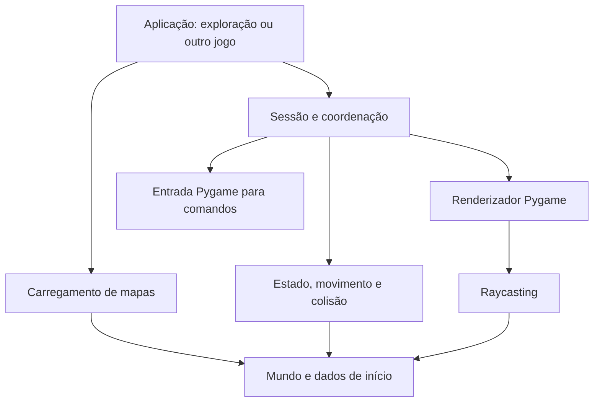

# Arquitetura inicial — RetroFPS Engine

## 1. Intenção e estado

A engine oferecerá mecanismos reutilizáveis para jogos baseados em ambientes de grade, inspirados visualmente em Wolfenstein 3D. Em M0-3, `engine.run()` passou a abrir a janela, processar eventos de encerramento e liberar recursos; `__main__` chama esse executor. M0-4 e M0-5 acrescentaram configuração da janela, medição em segundos e desenho de cor sólida. M1-1 implementou `World`, descrito na seção 11; M1-2 acrescentou a sala temporária descrita na seção 12. Os demais módulos permanecem esqueleto; os contratos abaixo continuam propostas, exceto onde identificados como implementados.

Reutilização significa que outro programa pode importar a engine, fornecer um mundo e controlar uma sessão sem copiar o renderizador ou editar suas regras internas. Não significa oferecer antecipadamente um editor, um sistema universal de plugins ou suporte a qualquer tipo de jogo.

## 2. Estrutura

```text
retro_fps_engine/
├── README.md
├── AGENTS.md
├── pyproject.toml
├── docs/
│   ├── missao.md
│   ├── pilha_tecnologica.md
│   ├── roadmap.md
│   ├── arquitetura.md
│   ├── formato_mapa.md
│   ├── validacao.md
│   └── uso_ia.md
├── src/retro_fps/
│   ├── __init__.py
│   ├── __main__.py
│   ├── config.py
│   ├── engine.py
│   ├── world.py
│   ├── player.py
│   ├── collision.py
│   ├── raycasting.py
│   ├── renderer.py
│   └── map_loader.py
├── examples/exploration/
├── maps/
│   ├── room.map
│   └── corridor.map
├── assets/textures/
└── tests/
```

## 3. Responsabilidades e limites

| Módulo | Responsabilidade planejada | Limite |
|---|---|---|
| `world` | Grade, dimensões e consultas de células | Sem janela, leitura de arquivo ou regras de vitória |
| `map_loader` | Leitura, análise e validação; criação dos dados do mundo e início | Sem iniciar Pygame |
| `player` | Estado de posição e orientação; intenção de movimento | Sem consultar teclado diretamente |
| `collision` | Validar volume e resolver deslocamento contra a grade | Sem desenhar ou decidir objetivos |
| `raycasting` | Percorrer grade e retornar impactos por raio | Sem dependência de Pygame |
| `renderer` | Converter impactos em colunas e apresentar piso e teto | Sem alterar o mundo ou o jogador |
| `engine` | Coordenar sessão, entrada, atualização, desenho e encerramento | Sem inventário, chave ou vitória |
| `examples/exploration` | Configurar e executar a demonstração usando a API pública | Sem duplicar algoritmos do núcleo |

Dependências seguem a direção dos mecanismos básicos: o coordenador usa os componentes; mundo e geometria não importam o coordenador nem os exemplos. Pygame fica concentrado na coordenação de entrada/apresentação e no renderizador.

## 4. Contratos iniciais a desenvolver

- **Mundo (implementado em M1-1):** grade retangular imutável, dimensões e consultas de células e solidez; contrato na seção 11.
- **Início:** posição e orientação separadas da geometria, permitindo que uma aplicação escolha outro início válido.
- **Estado do jogador:** posição contínua e ângulo em radianos. Velocidades e raio pertencem à configuração explícita da sessão, evitando valores escondidos em vários módulos.
- **Comando de movimento:** avanço e giro, independentes das teclas físicas. O adaptador de entrada traduz teclado em comandos; testes e outros jogos podem fornecer comandos diretamente.
- **Impacto de raio:** célula atingida, lado atingido e parâmetro de distância. Sua unidade deve ser documentada; a distância perpendicular depende da convenção da direção do raio.
- **Configuração:** resolução, campo de visão, velocidades e volume do jogador definidos explicitamente e validados antes da sessão.
- **Sessão:** a aplicação fornece mundo, início e configuração; pode solicitar atualização e desenho e controlar seu ciclo de vida. Um executor simples poderá cuidar do loop para a demonstração.

Os nomes e assinaturas serão definidos em cada marco, quando houver informação suficiente. A API pública só deverá ser exportada por `__init__.py` quando estiver implementada e testada.

## 5. Decisões geométricas propostas

A câmera será representada por direção unitária e um vetor perpendicular que representa o plano da câmera. Cada coluna usa uma direção calculada a partir desses vetores, sem normalizar individualmente esse raio. Com essa convenção, o parâmetro de impacto do DDA corresponde à profundidade perpendicular usada na projeção; não se aplica uma segunda correção por cosseno.

O jogador será um círculo de raio inicial 0.2 unidade. A colisão círculo-retângulo compara o centro com o ponto mais próximo na célula sólida. O deslocamento será resolvido por eixos para permitir deslizar ao longo de paredes; cantos e a influência da ordem dos eixos devem ser validados.

O movimento usa segundos e velocidade em unidades por segundo. A proposta inicial limita o intervalo aceito por atualização a 0.1 segundo e subdivide o deslocamento em passos de no máximo 0.1 unidade. Isso evita saltar uma parede com uma única verificação de destino. O tempo excedente após travamentos é descartado nesta abordagem; a limitação será explicada e poderá ser revista. Nenhuma dessas medidas substitui os testes de cantos e passos grandes.

## 6. Separação entre engine e jogo

Um jogo de fuga poderá usar a posição do jogador para verificar uma zona de saída e manter seu próprio estado de vitória. Outro poderá usar os mesmos componentes apenas para exploração. A engine não deve importar nenhum desses jogos.

A comprovação mínima de reutilização será o exemplo externo importar o pacote, carregar dois cenários e executar a mesma engine com configurações diferentes. Caso se adicione um jogo com objetivo, a regra deverá ficar fora de `src/retro_fps/`. Não é necessário construir um segundo jogo completo para validar a entrega básica.

## 7. Estilo arquitetural explícito

A proposta adota uma **arquitetura modular em um único processo, com separação entre núcleo computacional e infraestrutura de entrada e apresentação**. O pacote é uma biblioteca; a demonstração é uma aplicação cliente dessa biblioteca. Os limites são mantidos por módulos e contratos, sem serviços separados ou comunicação de rede.

Uma arquitetura descreve as partes principais, suas responsabilidades e as dependências permitidas. Um padrão de projeto resolve um problema mais localizado. Ter um arquivo por responsabilidade ajuda, mas os limites só existirão de fato se as dependências e o comportamento os respeitarem. Atualmente temos o ciclo inicial de janela e o mundo independente de Pygame; as relações com os demais componentes geométricos ainda aguardam implementação.

### Organização lógica e dependências



As setas representam dependência de código planejada, não a ordem de execução. Os blocos são responsabilidades lógicas; não exigem criar um arquivo ou classe para cada um imediatamente.

O carregador e os adaptadores gráficos ficam nas bordas. Mundo, colisões e raycasting não conhecem arquivos de demonstração, teclas ou janela. A coordenação pode conhecer componentes concretos inicialmente; não estamos prometendo uma infraestrutura gráfica totalmente substituível desde o primeiro marco.

### Relação com arquitetura hexagonal e Clean Architecture

A proposta aproveita a ideia de manter a lógica interna utilizável por diferentes entradas. Um comando de avanço pode vir do teclado, de um teste ou de outro programa. Essa ideia é central à [arquitetura hexagonal de Alistair Cockburn](https://alistair.cockburn.us/hexagonal-architecture/).

Ainda não adotamos uma arquitetura hexagonal completa com todas as portas e adaptadores formalizados, nem as camadas formais da Clean Architecture. Chamá-la de uma implementação completa desses estilos seria antecipar estruturas que ainda não existem. Se surgir necessidade real de trocar apresentação ou controle, poderemos definir contratos explícitos, por exemplo com `typing.Protocol`, nas fronteiras relevantes.

Também não adotamos MVC formal: embora existam dados e apresentação separados, a interação da engine será organizada pelo ciclo de atualização e desenho, sem exigir a divisão clássica em Model, View e Controller.

## 8. Padrões e princípios que orientam a implementação

| Padrão ou princípio | Aplicação planejada | Benefício e cuidado |
|---|---|---|
| Game Loop | Repetir coleta de entrada, atualização do estado e desenho | Torna explícita a evolução no tempo; o loop não deve acumular toda a lógica |
| Separação de responsabilidades | Leitura em `map_loader`, geometria em `raycasting`, desenho em `renderer` | Permite entender e testar partes menores; separar arquivos sem separar dependências não basta |
| Composição | Criar a sessão fornecendo mundo e configuração | Jogos combinam os mesmos mecanismos; evitar uma árvore de subclasses para cada jogo |
| Injeção de dependências por parâmetros | Fornecer componentes e dados ao coordenador em vez de buscá-los em variáveis globais | Facilita testar e reutilizar; não exige um framework de injeção |
| Núcleo funcional e borda com efeitos | Preferir cálculos que recebem dados e retornam resultados; concentrar arquivo, teclado e tela nas bordas | Facilita conferir matemática; o estado da sessão continua mudando, portanto não é um programa puramente funcional |

A sequência de Game Loop é coerente com o [exemplo básico da documentação do Pygame](https://www.pygame.org/docs/). Atualização e apresentação são responsabilidades distintas mesmo quando ocorrem no mesmo laço e na mesma frequência inicial.

Um comando lógico de movimento será inicialmente um dado simples. Isso não implica adotar o padrão Command com objetos executáveis, histórico ou desfazer. Da mesma forma, usar módulos não implica adotar ECS, e fornecer dependências por parâmetro não exige interfaces abstratas para todas as funções.

### Exemplo prático de reutilização

Em um teste, fornecemos um mundo conhecido e o comando de avançar por determinado intervalo; conferimos a posição resultante sem abrir janela. Na demonstração, uma tecla produz o mesmo comando e a tela mostra o resultado. Em um jogo de fuga, a aplicação consulta a posição depois da atualização e decide se uma condição de vitória foi atendida.

A regra de vitória pode mudar sem alterar DDA ou colisões. O teclado pode mudar sem alterar as equações do movimento. Esse é o resultado arquitetural que buscamos demonstrar.

## 9. Por que não começar com outras arquiteturas

- **ECS — Entity Component System:** seria uma alternativa ao lidar com muitas entidades compostas por capacidades combináveis. O recorte atual tem essencialmente mundo e jogador; introduzir sistemas e armazenamento genérico agora acrescentaria conceitos sem um problema comprovado.
- **Hierarquia extensa de herança:** uma classe base para todo objeto de jogo tenderia a reunir responsabilidades distintas. Preferimos compor dados e comportamentos conforme aparecerem usos concretos.
- **Barramento global de eventos ou Singleton para a engine:** não são necessários para coordenar poucos módulos e podem tornar dependências menos visíveis. Chamadas e parâmetros explícitos são suficientes inicialmente.
- **Microsserviços:** o projeto é uma simulação gráfica local. Distribuir seus componentes exigiria protocolos e coordenação sem benefício identificado.

Essas escolhas não impedem aprender os estilos ao longo do projeto. A implementação só deve introduzi-los quando houver um problema específico, um benefício demonstrável e critérios para verificar que a solução ficou mais compreensível.

## 10. Comportamento implementado em M0

`engine.run()` inicializa apenas o subsistema de exibição, pois esta etapa não usa áudio ou outros recursos. Abre uma janela de 640 × 480 pixels e consulta os eventos até receber `QUIT` ou `KEYDOWN` com Escape. Um bloco `finally` executa `pygame.quit()` também se a criação da janela falhar; o erro continua sendo propagado.

Em M0-4 e M0-5, `WindowConfig` passou a reunir as opções de janela (padrões e exemplo no README). É uma dataclass imutável, sem dependência gráfica; rejeita dimensões e limite de frequência que não sejam inteiros positivos e cores que não tenham três canais inteiros entre 0 e 255. `run(config=None)` cria uma configuração padrão quando nenhuma é fornecida.

A cada iteração, `Clock.tick(config.frame_limit)` limita a frequência e retorna o intervalo em milissegundos, convertido para segundos por divisão por 1000. Por exemplo, 20 ms correspondem a 0.020 s. O valor é mostrado no título, arredondado a três casas; ainda não há simulação que o consuma. O primeiro intervalo inclui o tempo desde a criação do relógio, não um quadro anterior completo. O limite não garante taxa exata nem precisão de temporização.

Após processar os eventos, se não houver pedido de saída, `screen.fill()` preenche a superfície e `pygame.display.flip()` apresenta o quadro. Não se desenha outro quadro após detectar o encerramento. Esta etapa não implementa projeção, movimento ou uma configuração completa de sessão.

## 11. Mundo implementado em M1-1

`World`, importado de `retro_fps.world`, recebe uma sequência de linhas e copia os dados para uma tupla de tuplas. A dataclass imutável impede substituir a grade; mudanças posteriores na lista de entrada não afetam o mundo. A construção exige pelo menos uma célula, linhas de mesmo comprimento e valores inteiros `0` (livre) ou `1` (parede), rejeitando violações com `ValueError`. Booleanos não são aceitos como células.

`width` conta colunas e `height` conta linhas. As consultas recebem índices inteiros `(x, y)` e acessam `grid[y][x]`, conforme as [convenções de coordenadas](formato_mapa.md#3-coordenadas-e-medidas). Tipos diferentes, incluindo booleanos e números fracionários, causam `TypeError`; não há conversão automática de posições contínuas.

| Consulta | Dentro da grade | Fora da grade |
|---|---|---|
| `contains(x, y)` | `True` | `False` |
| `cell_at(x, y)` | Valor `0` ou `1` | `IndexError` |
| `is_solid(x, y)` | `True` para parede; `False` para livre | `True` |

A verificação explícita de limites impede que índices negativos acessem a última linha ou coluna por convenção do Python. Considerar o exterior sólido prepara a consulta para colisões, mas ainda não implementa colisão ou encerramento de raios.

O mundo em memória permite dimensões pequenas e bordas abertas para estudo. Tamanho mínimo de mapas externos, bordas fechadas e início válido serão responsabilidades do carregador em M4. M1-1 não cria sala padrão nem lê arquivos. As [evidências de validação](validacao.md#10-m1-1--representação-do-mundo-e-consulta-de-células) registram os testes e a conferência do desenvolvedor.


## 12. Sala temporária implementada em M1-2

`create_study_world() -> World`, em `retro_fps.study_world`, constrói a sala 5 × 5 do [exemplo de validação](validacao.md#2-exemplo-independente-de-raycasting), com borda sólida e interior livre. Cada chamada retorna um novo `World`, usando uma grade explícita em memória. O cenário de estudo fica separado da representação genérica do mundo e não é exportado por `__init__.py`.

O módulo não depende de Pygame nem lê arquivos. A função não define jogador, não lança raios e não altera a janela; será usada no estudo das tarefas seguintes. A substituição por mapas externos permanece prevista para M4. Ver [evidências de M1-2](validacao.md#11-m1-2--sala-temporária-em-memória).


## 13. Raios implementados em M1-3 e M1-4

`cast_ray(world, origin, direction) -> RayHit | None`, em `retro_fps.raycasting`, recebe dois pares de coordenadas e percorre a grade com DDA, sem Pygame. `RayHit` é imutável e contém `cell_x`, `cell_y`, `side` e `parameter`. O lado `"x"` significa fronteira vertical e `"y"`, horizontal. O ponto de impacto é `origin + parameter × direction`; a direção não é normalizada, portanto o parâmetro não é necessariamente distância euclidiana.

A origem precisa estar numa célula livre; direção nula e coordenadas não finitas são rejeitadas com `ValueError`. A célula inicial é obtida pelo piso matemático. Na fronteira de uma célula, apontar para o sentido negativo pode produzir impacto com parâmetro zero. A saída da grade retorna `None`, sem inventar uma parede externa.

O DDA mantém o parâmetro da próxima fronteira e o incremento entre fronteiras para cada eixo; componentes nulas usam infinito e não dividem por zero. A prioridade de x em empate já está expressa na comparação; testes específicos de cantos e limite explícito de avanços serão consolidados em M1-5. Os símbolos ficam neste módulo, sem exportação em `__init__.py`.
